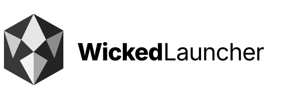

<p align="center">
  <picture>
    <source media="(prefers-color-scheme: dark)" srcset="io.github.w1ckeddamn.WickedLauncher.logo-darkmode.svg" type="image/svg+xml">
    
  </picture>
</p>

# Wicked Launcher — Program Info

This directory contains the non-code assets and metadata used to package and brand Wicked Launcher.

It covers:

- Application identity: display name, internal name, AppID, URLs, and copyright
- Branding: application icons, wordmarks, social banners, and monochrome assets
- Desktop integration: `.desktop` entry, AppStream metadata, MIME types, and man page
- Platform packaging: Windows resource/manifest files and macOS icon assets

> **Compatibility note:** the application ID is `io.github.w1ckeddamn.WickedLauncher` and the binary/common name is `WickedLauncher`. The legacy `prismlauncher://` URL scheme remains registered because it is the Microsoft login redirect URI and is used by older import links.

---

## Branding Assets

The visual identity is a faceted **W crystal** mark. Light and dark variants are provided so the mark stays readable on both backgrounds.

| File | Purpose |
| :--- | :--- |
| `io.github.w1ckeddamn.WickedLauncher.svg` | Square application icon (transparent background) |
| `io.github.w1ckeddamn.WickedLauncher.Source.svg` | Editable source for the square application icon |
| `io.github.w1ckeddamn.WickedLauncher.bigsur.svg` | macOS application icon with squircle background |
| `io.github.w1ckeddamn.WickedLauncher.logo.svg` | Horizontal wordmark for light backgrounds |
| `io.github.w1ckeddamn.WickedLauncher.logo-darkmode.svg` | Horizontal wordmark for dark backgrounds |
| `io.github.w1ckeddamn.WickedLauncher.logo.source.svg` | Editable source for the horizontal wordmark |
| `io.github.w1ckeddamn.WickedLauncher.Social.svg` | Social banner with light and dark panels |
| `wickedlauncher-monochrome.Source.svg` | Monochrome banner with light and dark panels |
| `WickedLauncher.icon/` | macOS Icon Composer assets (`icon.json`, `Assets/block.svg`, `Assets/rainbow.svg`) |

Generated binary icons:

| File | Purpose |
| :--- | :--- |
| `io.github.w1ckeddamn.WickedLauncher_256.png` | 256×256 PNG master used by packaging |
| `wickedlauncher.ico` | Windows multi-resolution icon (16–256 px) |
| `wickedlauncher.icns` | macOS multi-resolution icon (16–1024 px) |

The launcher theme uses a copy of the square icon:

```text
launcher/resources/multimc/scalable/launcher.svg
```

---

## Regenerating Icons

Edit the SVG sources, then regenerate the binary icons with:

```bash
cd program_info
./genicons.sh
```

The script expects the following tools in `PATH`:

- `inkscape` — SVG rasterization
- `icotool` and `oxipng` — Windows `.ico` generation and optimization
- `iconutil` — macOS `.icns` generation (macOS only)

`genicons.sh` also copies the square application icon to the launcher theme path.

Do not edit the generated `.png`, `.ico`, or `.icns` files by hand. If the tools above are unavailable, regenerate from the SVG sources using your platform's SVG renderer, preserving transparency and the full icon bounds.

---

## Metadata Files

| File | Purpose |
| :--- | :--- |
| `io.github.w1ckeddamn.WickedLauncher.desktop.in` | Linux desktop entry template |
| `io.github.w1ckeddamn.WickedLauncher.metainfo.xml.in` | AppStream metadata template |
| `io.github.w1ckeddamn.WickedLauncher.mime.xml` | MIME type associations |
| `wickedlauncher.6.scd.in` | Man page source |
| `wickedlauncher.rc.in` | Windows resource definition |
| `wickedlauncher.manifest.in` | Windows application manifest |
| `wickedlauncher.qrc.in` | Qt resource file for the application icon |
| `win_install.nsi.in` | NSIS installer script |

The build system configures these templates and copies the icon assets into the build directory. See [`CMakeLists.txt`](CMakeLists.txt) for the exact variables and output paths.

---

## License & Attribution

- Wicked Launcher is licensed under the GNU General Public License v3.0. See the repository root [`LICENSE`](../LICENSE).
- Artwork, logos, and branding assets are licensed under [CC BY-SA 4.0](https://creativecommons.org/licenses/by-sa/4.0/).
- Wicked Launcher is an independent fork of [Prism Launcher](https://github.com/PrismLauncher/PrismLauncher) and is not affiliated with or endorsed by Prism Launcher, MultiMC, or Mojang Studios.
